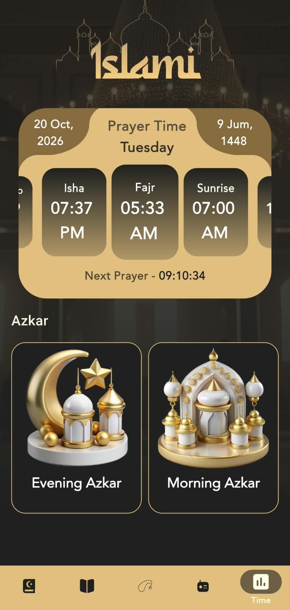
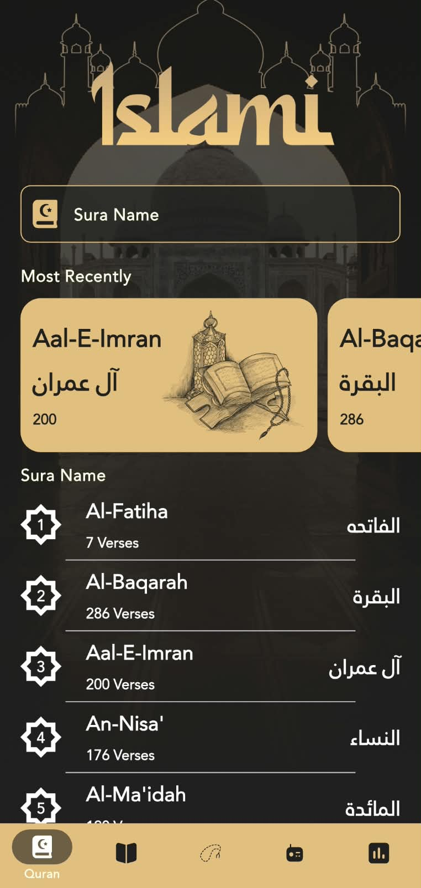
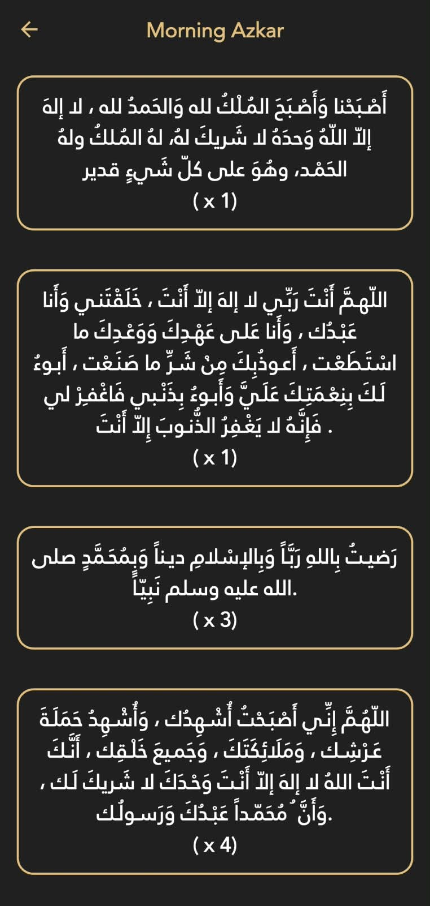
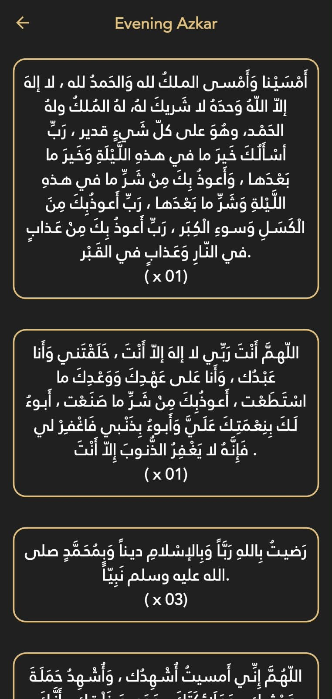
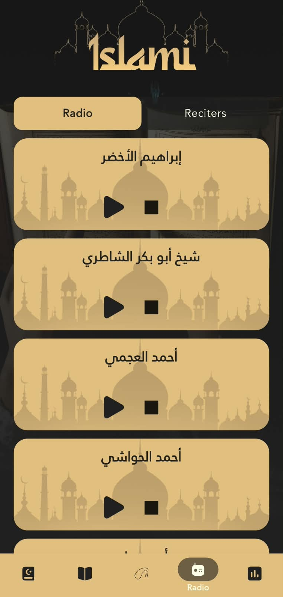

# 🕌 Islami App

A Flutter mobile application designed to bring useful Islamic features together in one simple, user-friendly experience.

## ✨ Features

- 🕌 **Prayer Times** — View daily prayer times and the countdown until the next prayer.
- 📖 **Holy Quran** — Browse and read Quran content.
- 🌅 **Morning Azkar** — Access morning remembrance.
- 🌙 **Evening Azkar** — Access evening remembrance.
- 📿 **Tasbeeh** — Keep track of Tasbeeh counts.
- 📻 **Islamic Radio** — Listen to Islamic radio streams.
- 🎙️ **Hadith** — View Hadith content.
- 📱 **Responsive UI** — Layouts designed for different screen sizes.
- 👋 **Onboarding** — Introductory screens for new users.

## 🛠️ Built With

- **Flutter** and **Dart**
- **Provider** for state management
- **REST APIs** for retrieving remote content
- **SharedPreferences** for lightweight local preferences
- **Audioplayers** for audio playback

## 📸 Screenshots

### Prayer Times
<p align="center">
  
</p>

### Quran
<p align="center">
  
</p>

### Morning & Evening Azkar
<p align="center">
  
  &nbsp;&nbsp;
  
</p>

### Tasbeeh
<p align="center">
  
</p>

### Islamic Radio
<p align="center">
  
</p>

### Hadith
<p align="center">
  
</p>

## 🚀 Getting Started

### Prerequisites

- Flutter SDK
- Dart SDK
- Android Studio or VS Code
- Android emulator or physical Android device

### Run Locally

1. Clone this repository:

   ```bash
   git clone https://github.com/omarazzam25/Islami-App
   ```

2. Move into the project directory:

   ```bash
   cd Islami-App
   ```

3. Install dependencies:

   ```bash
   flutter pub get
   ```

4. Run the app:

   ```bash
   flutter run
   ```

## 📚 What I Practiced

- Managing app state with Provider.
- Integrating REST APIs.
- Saving lightweight preferences locally.
- Building responsive Flutter UI.
- Implementing audio playback.
- Organizing reusable UI components and app resources.

## 👨‍💻 Developer

**Omar Azzam** — Flutter Developer

- GitHub: [@omarazzam25](https://github.com/omarazzam25)
- LinkedIn: [Omar Azzam](https://www.linkedin.com/in/omar-azzam-1903ab220/)

---

*Built with Flutter 💙*
